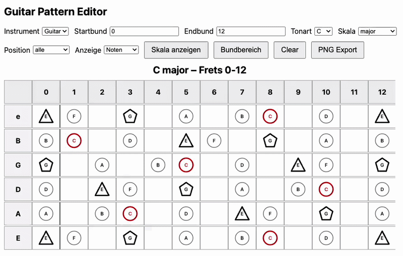

# Guitar Pattern Editor

Interactive fretboard tool for exploring scales and patterns on **guitar and bass**.

The editor allows you to visualize scales, explore interval relationships and
create custom note patterns directly on the fretboard.

## Demo



## 🎸 Try the App

[](https://app.guitarpattern.net)

## Features

- Guitar fretboard
- Bass fretboard
- Select root note
- Select scale
- Custom fret range
- Interval / note display
- Click notes to build patterns

## Screenshots

### Guitar – C Major Scale


### Bass – C# Minor (Frets 4–9)


## Usage

1. Select **instrument**
2. Choose **root note**
3. Choose **scale**
4. Adjust fret range if needed
5. Click notes to build patterns

## Roadmap

Planned features:

- Sequence mode for solo ideas
- Line visualization
- Pattern saving
- Export diagrams
- Mobile PWA version

## Technology

- Vanilla JavaScript
- SVG based fretboard rendering
- GitHub Pages hosting
- Progressive Web App (PWA)

## License

MIT License

## Author

Created by Michael Bollow

## Short tablatures

Enable **Sequence Mode**, select a duration (whole, half, quarter, eighth or
sixteenth note), then click a string/fret position. Each click appends a note,
including repeated notes at the same position. **Pause einfügen** appends a rest
of the selected duration. Playback uses the actual string octave and respects rests.

The TAB preview contains four 4/4 bars, beat numbers and explicit duration labels
(`1/4`, `1/8`, etc.). A rhythm row below each TAB staff adds noteheads, stems and individual flags (one for eighth notes, two for sixteenths); whole and half notes have open noteheads. Empty space is unfinished input, not an implicit rest.
New notes must fit in the remaining part of a bar. Under **Sequenz bearbeiten**,
change individual durations or delete entries. Existing saved sequences longer
than four bars are preserved and displayed in additional bars.

Use **Save / Load** to keep sequences in this browser's local storage,
**TAB als SVG speichern** for a vector export, or **TAB drucken / PDF** for the
browser's print dialog. The existing **Export PNG** still exports the fretboard.
Single notes and rests are supported; chords, dotted notes, triplets and guitar
techniques are outside this first version. Standard guitar and bass tunings are supported.

Saved patterns belong to the browser and origin. The move from GitHub Pages to
Plesk retains them when the same `https://app.guitarpattern.net` address and browser
are used; another browser or address has separate storage.

### Validation

Run the rhythm, persistence and playback checks with Node.js:

```sh
node --test tests/tab.test.cjs
```

### Release workflow

Changes are submitted on a feature branch through a pull request. After review,
merge into `main`, then use **Pull now** and **Deploy now** in Plesk. Deploy the
repository root to the document root of `app.guitarpattern.net`.
